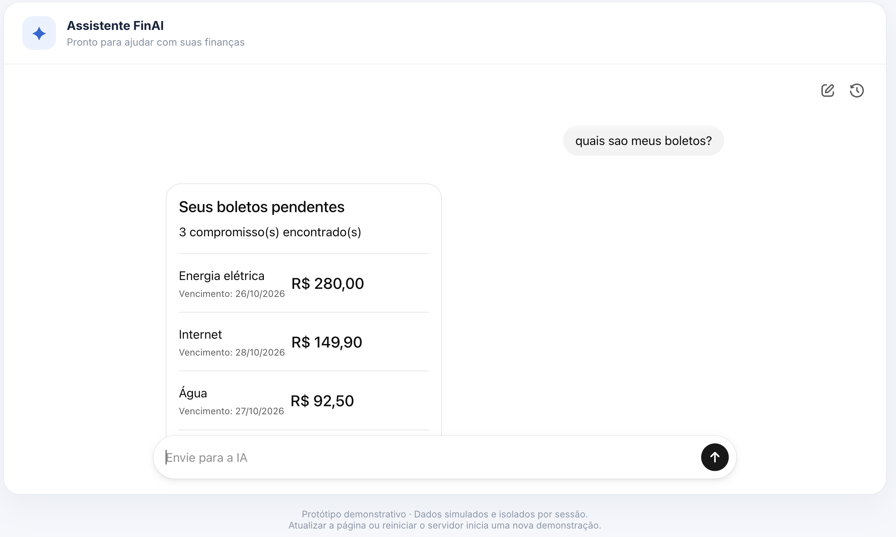
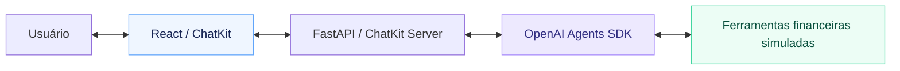

# Assistente Financeiro Inteligente

## Visão geral

Uma PoC para estudar e validar **OpenAI Agents SDK e ChatKit** em um assistente
financeiro conversacional. O foco é a orquestração de ferramentas e a execução
segura de pagamentos simulados, com aprovação humana antes de qualquer débito.

O LLM interpreta a solicitação; as ferramentas consultam os dados e aplicam as
regras financeiras. O modelo configurado é `gpt-6-luna`.

## Demonstração

[Acessar a demonstração na AWS](https://finai-demo.bfcx177kvsf1j.us-east-1.cs.amazonlightsail.com/)

A versão publicada pode diferir desta branch. Nenhum pagamento movimenta dinheiro real.



Experimente: “Qual é meu saldo?”, “Quais boletos estão pendentes?” ou
“Monte um plano de pagamentos”. Veja o [roteiro completo](docs/demonstracao.md).

## Funcionalidades

- Consulta de saldo e de limite do cartão, apresentados separadamente.
- Busca de boletos por descrição e listagem de pendências.
- Planejamento de pagamentos por vencimento, considerando o saldo disponível.
- Pagamento simulado com aprovação ou rejeição humana (**HITL**).
- Validação de saldo insuficiente, boleto inexistente e pagamento duplicado.
- Interface conversacional com widgets de saldo, boletos e aprovação.

## Tecnologias e arquitetura

**Python · OpenAI Agents SDK · OpenAI ChatKit · FastAPI · React/Vite · Pydantic**



O SDK controla as chamadas às ferramentas e interrompe `pagar_boleto` para revisão
humana. Aprovar permite executar; rejeitar retoma a conversa sem realizar o pagamento.
A confirmação de sucesso depende do resultado financeiro da ferramenta.

## Como executar localmente

Pré-requisitos: **Python 3.13**, **Node.js 22**, npm e uma chave da API OpenAI.
Os comandos abaixo partem da raiz do repositório, em um terminal Bash ou zsh.

**1. Prepare o ambiente Python:**

```sh
python3 -m venv .venv
.venv/bin/python -m pip install -r requirements.txt
```

**2. Inicie o backend no primeiro terminal:**

```sh
export OPENAI_API_KEY="SUA_CHAVE_OPENAI"
export APP_ENV=development
export CORS_ORIGINS=http://localhost:5173
.venv/bin/python -m uvicorn api:app --app-dir test-ui --reload --port 8000
```

Mantenha a chave somente no backend, fora do Git e de variáveis `VITE_*`.
O backend lê o ambiente do processo; não carrega `.env` automaticamente.

**3. Inicie o frontend em outro terminal, também a partir da raiz:**

```sh
cd test-ui/frontend
npm ci
npm run dev -- --port 5173 --strictPort
```

Abra [http://localhost:5173](http://localhost:5173). O backend responde em
[http://localhost:8000/health](http://localhost:8000/health).
Mantenha os dois servidores abertos; use `Ctrl+C` para encerrar cada um.
A configuração padrão do frontend já aponta para o backend local.

## Testes

Na raiz, execute os testes sem chamadas ao modelo e as regras financeiras:

```sh
PYTHONPATH=assistente-organizacao-financeira .venv/bin/python -m unittest discover -s assistente-organizacao-financeira/tests -v
PYTHONPATH=assistente-organizacao-financeira:test-ui .venv/bin/python -m unittest discover -s test-ui/tests -v
PYTHONPATH=assistente-organizacao-financeira .venv/bin/python assistente-organizacao-financeira/tests/test_pagamentos.py
```

Para evals com o modelo real, configure `OPENAI_API_KEY` no terminal:

```sh
cd assistente-organizacao-financeira
PYTHONPATH=. ../.venv/bin/python tests/test_avaliar_agente.py
PYTHONPATH=. ../.venv/bin/python tests/test_hitl.py
../.venv/bin/python evals.py
```

Os evals incluem seleção de ferramentas, HITL, Answer Quality e LLM-as-a-Judge.
Chamadas à API têm custo. Os comandos padrão não aprovam pagamentos;
use a interface ou `evals.py --aprovacao-manual` para decidir manualmente.

## Limitações

- Finanças e conversas web são isoladas por sessão e mantidas em memória.
- Atualizar a página inicia outra sessão; reiniciar o backend perde o estado web.
- A PoC usa uma instância e um worker, sem persistência financeira durável.
- O acesso é anônimo; limites locais de requisições não substituem autenticação.

## Documentação complementar

- [Demonstração: perguntas e cenários de aprovação](docs/demonstracao.md).
- [Arquitetura, Agents SDK e aprovação humana](docs/arquitetura.md).
- [Material de estudo: conceitos e experimentos](docs/estudo_revisado.md).
- [Configuração, sessões e execução pelo terminal](deploy/README.md).
- [Deploy na AWS: container, variáveis e publicação no Lightsail](deploy/aws/README.md).
