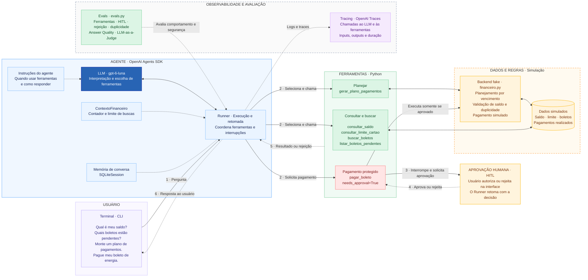

# Assistente Financeiro Inteligente

PoC com OpenAI Agents SDK, backend Python/FastAPI e interface React com ChatKit.
Consulta saldo e boletos, planeja pagamentos e executa pagamentos **simulados**
somente após aprovação humana. O modelo configurado é `gpt-6-luna`.

## Executar a interface web localmente

São necessários **dois servidores em dois terminais**: o backend na porta 8000
conversa com a OpenAI e executa as ferramentas; o frontend na porta 5173 exibe a
interface. Mantenha os dois terminais abertos durante o uso.

### 1. Preparar as dependências

Na raiz do projeto, com Python 3.13 e Node.js 22 instalados:

```sh
cd /Users/damianacosta/Projetos/test-openai-sdk
python3 -m venv .venv  # somente se o ambiente ainda não existir
.venv/bin/python -m pip install -r requirements.txt
cd test-ui/frontend
npm ci
```

O caminho acima corresponde à instalação local atual; em outra máquina, use a
pasta em que clonou o repositório.

### 2. Terminal 1 — iniciar o backend

```sh
cd /Users/damianacosta/Projetos/test-openai-sdk
read -s "OPENAI_API_KEY?Chave OpenAI: "
export OPENAI_API_KEY
printf '\n'
.venv/bin/python -m uvicorn api:app --app-dir test-ui --reload --port 8000
```

A entrada oculta da chave usa o shell **zsh**, padrão do macOS. A chave fica apenas
no ambiente desse terminal. O backend não carrega arquivos `.env` automaticamente.
Nunca coloque a chave em variáveis `VITE_*`, no frontend ou no Git.

Abra [a verificação do backend](http://localhost:8000/health): deve retornar
`{"status":"ok","state":"ephemeral"}`. O argumento `--app-dir test-ui` evita o
erro `Could not import module "api"` ao iniciar pela raiz.

### 3. Terminal 2 — iniciar o frontend

```sh
cd /Users/damianacosta/Projetos/test-openai-sdk/test-ui/frontend
npm run dev -- --port 5173 --strictPort
```

Abra **[http://localhost:5173](http://localhost:5173)**. O frontend usa
`http://localhost:8000/chatkit` por padrão. A origem local autorizada no backend é
`http://localhost:5173`; use esse endereço para evitar erros de CORS. Se a porta
estiver ocupada, encerre o servidor anterior antes de iniciar outro.

Se houver configurações antigas em `test-ui/frontend/.env.local`, confira se
`VITE_CHATKIT_API_URL` aponta para o backend local e reinicie o Vite após alterar.
Se `DEMO_ACCESS_CODE` estiver definido no terminal do backend, a interface também
solicitará esse código. Para encerrar os servidores, pressione `Ctrl+C` em cada terminal.

## Testar a demonstração na internet

1. Abra a [aplicação pública na AWS](https://finai-demo.bfcx177kvsf1j.us-east-1.cs.amazonlightsail.com/).
   A versão publicada funciona sem iniciar os servidores locais.
2. Informe o código de acesso da demonstração, compartilhado separadamente pelo
   responsável. É o mesmo código de entrada para os convidados; cada acesso recebe
   uma sessão própria. Não coloque esse código no README ou no repositório.
3. Consulte o saldo e os boletos usando as perguntas abaixo. Confira também os
   widgets apresentados na conversa.
4. Solicite o pagamento de energia e clique em **Rejeitar** no cartão de aprovação.
   Consulte o saldo novamente: deve continuar em **R$ 350,00**.
5. Solicite o pagamento de energia outra vez. Confirme os dados e, se quiser testar
   a execução simulada, clique manualmente em **Aprovar**. Consulte o saldo: deve
   passar para **R$ 70,00**. Nenhum dinheiro real é movimentado.
6. Na mesma sessão, tente pagar a energia novamente: não deve haver novo débito.
   Depois tente pagar a internet: o saldo restante é insuficiente.
7. Abra outro navegador ou uma janela anônima, entre novamente e consulte o saldo:
   a nova sessão deve começar em **R$ 350,00**, sem os pagamentos da anterior.

Faça os passos 3 a 6 **sem atualizar a página**, para manter a mesma sessão.
Antes da aprovação, o pagamento deve permanecer pendente e o saldo não pode mudar.
Se solicitar vários pagamentos, decida em cada cartão exibido; uma aprovação não
vale para todos os boletos.

### Perguntas para experimentar

| Objetivo | Pergunta | O que conferir |
| --- | --- | --- |
| Consultar saldo | “Qual é meu saldo disponível?” | Saldo inicial de R$ 350,00 |
| Listar boletos | “Quais boletos estão pendentes? Mostre os valores e os IDs.” | Energia BOL-001: R$ 280,00; internet BOL-002: R$ 149,90; água BOL-003: R$ 92,50 |
| Planejar sem pagar | “Monte um plano de pagamentos com meu saldo atual, priorizando os vencimentos.” | Na sessão inicial, energia selecionada e sobra de R$ 70,00; nenhum pagamento executado |
| Verificar o total | “Meu saldo é suficiente para pagar todos os boletos?” | Total inicial de R$ 522,40, acima do saldo disponível |
| Testar HITL | “Quero pagar o boleto de energia BOL-001.” | Cartão para aprovar ou rejeitar antes da execução |
| Conferir rejeição | “Qual é meu saldo e quais boletos continuam pendentes?” | Após rejeitar, saldo e boletos não mudam |
| Testar duplicidade | “Pague novamente o boleto BOL-001.” | Após um pagamento aprovado, não pode haver novo débito |
| Testar saldo insuficiente | “Quero pagar a internet BOL-002.” | Após pagar energia, não pode debitar os R$ 149,90 do saldo de R$ 70,00 |
| Testar vários pedidos | “Quero pagar BOL-001, BOL-002 e BOL-003.” | Em uma sessão nova, decisões individuais; rejeite todos para preservar o saldo |

As respostas são geradas pelo modelo e podem variar de texto. Confira os valores,
os resultados das ferramentas e o fluxo de aprovação, não uma frase exata.

**Limites da demonstração:** o estado financeiro é isolado por sessão e mantido em
memória. Atualizar a página inicia uma nova sessão; reiniciar o backend perde as
conversas e o estado da simulação. A chave OpenAI permanece exclusivamente no
backend. As chamadas ao modelo consomem a API OpenAI. Não use dados pessoais reais.

## Executar somente pelo terminal

Esta é uma alternativa à interface web e não exige os dois servidores. Na raiz,
com `OPENAI_API_KEY` já exportada:

```sh
cd assistente-organizacao-financeira
../.venv/bin/python agent.py
```

O fluxo HITL solicita a decisão no próprio terminal. A sessão SQLite é criada em
`conversas_financeiras.db` no diretório de execução. Arquivos locais de sessão e
credenciais são ignorados pelo Git.

## Publicação e configuração

O [guia AWS](deploy/aws/README.md) documenta o container único que serve o frontend
e o backend, a configuração privada e os comandos de publicação no Lightsail.
O [guia de configuração e validação](deploy/README.md) reúne orientações sobre
sessões, variáveis de ambiente e testes. Alterações locais só chegam à URL pública após
um novo deploy; o ajuste local mais recente de CORS ainda não foi publicado.

## Arquitetura


O fluxo segue quatro blocos: **usuário → agente → ferramentas → dados simulados**.
O LLM interpreta a solicitação e escolhe ferramentas; o OpenAI Agents SDK controla
sua execução. Para pagamentos, o SDK interrompe o fluxo antes de executar a
ferramenta e aguarda a decisão humana na interface web ou no terminal.

### Diagrama em Mermaid

A versão abaixo acompanha a organização e as cores da imagem: interação em roxo,
agente em azul, ferramentas em verde, pagamento em vermelho e simulação em âmbar.



**Aprovação:** autorizar retoma o Runner e permite executar `pagar_boleto`.
Rejeitar retoma a conversa sem executar o pagamento. O LLM não autoriza a operação.

**Backend substituível:** os dados e as regras simulados rodam no mesmo processo
Python. O limite do cartão e algumas consultas são valores fixos nas ferramentas;
o saldo e os pagamentos realizados são mantidos em memória em `financeiro.py`.
A integração futura com serviços reais acontecerá pelas ferramentas.

**Memória:** o SQLite armazena o histórico da conversa, não o estado financeiro.
O tracing acompanha a interação, incluindo a interrupção e a retomada do HITL.

### Onde cada parte está no código

| Parte do desenho | Implementação atual |
| --- | --- |
| Interação | `agent.py` inicia `terminal.py`; `hitl.py` coleta a decisão humana |
| Agente e LLM | `configuracao.py` define modelo, instruções e ferramentas; `ContextoFinanceiro.py` mantém o contexto |
| Ferramentas | `ferramentas.py` adapta as operações para o SDK |
| Backend fake | `financeiro.py` contém estado e regras; algumas consultas fixas ainda estão em `ferramentas.py` |
| Memória | `SQLiteSession` mantém o histórico, separado do estado financeiro em memória |
| Observabilidade | `terminal.py` cria um trace por interação, incluindo execução e retomada |
| Avaliações | `evals.py` verifica ferramentas, HITL, rejeição, duplicidade, Answer Quality e LLM-as-a-Judge |

**Futura integração:** substituir os dados e operações simulados por chamadas a
serviços reais, mantendo as ferramentas como ponto de integração. O backend fake
é uma separação lógica: hoje ele roda no mesmo processo Python, sem servidor HTTP
ou banco transacional.

## Organização

- `agent.py`: entrada e compatibilidade dos imports existentes.
- `configuracao.py`: agentes, instruções, modelo e ferramentas habilitadas.
- `financeiro.py`: estado e regras financeiras simuladas, sem SDK.
- `ferramentas.py`: adaptação das operações para ferramentas do SDK.
- `ContextoFinanceiro.py`: contexto e exceção de limite de buscas.
- `terminal.py`: terminal, sessão, tracing e tratamento de erros.
- `hitl.py`: decisão humana e retomada das interrupções.
- `evals.py`: avaliações comportamentais, de segurança e de qualidade.
- `example.py`: exemplo independente da API Responses.

## Validação local

Sem credenciais e sem chamadas à API:

```sh
.venv/bin/python -m unittest discover -s assistente-organizacao-financeira/tests -v
```

Os testes verificam planejamento, duplicidade, início pelo terminal e interrupção/rejeição
HITL usando o Runner do SDK, um modelo local controlado e SQLite temporário.
Nenhum pagamento é aprovado automaticamente. Isso não substitui as avaliações com modelos.

Identificadores inexistentes, saldo insuficiente e pagamentos duplicados retornam
os erros previstos pelas regras financeiras atuais.
