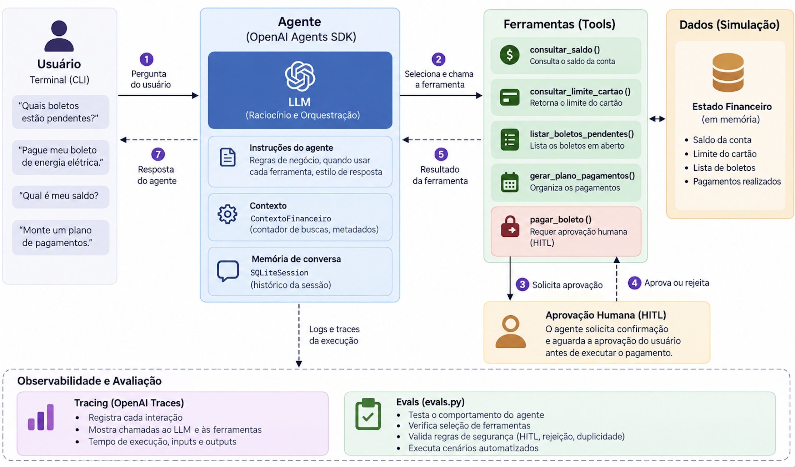

# PoC de organização financeira

Configure a chave na variável de ambiente, sem incluí-la no código:

```sh
export OPENAI_API_KEY="SUA_CHAVE_OPENAI"
```

Com o ambiente virtual existente e suas dependências instaladas:

```sh
cd assistente-organizacao-financeira
../.venv/bin/python agent.py
../.venv/bin/python evals.py
```

O modelo configurado é `gpt-6-luna`. As avaliações com modelos exigem acesso à API.
Pagamentos solicitados pelo agente exigem aprovação humana no terminal.
A sessão SQLite é criada em `conversas_financeiras.db` no diretório de execução.
Arquivos locais de sessão e credenciais são ignorados pelo Git.

## Arquitetura



O fluxo segue quatro blocos: **usuário → agente → ferramentas → dados simulados**.
O LLM interpreta a solicitação e escolhe ferramentas; o OpenAI Agents SDK controla
sua execução. Para pagamentos, o SDK interrompe o fluxo antes de executar a
ferramenta e aguarda a decisão humana no terminal.

### Diagrama em Mermaid

A versão abaixo acompanha a organização e as cores da imagem: interação em roxo,
agente em azul, ferramentas em verde, pagamento em vermelho e simulação em âmbar.


**Aprovação:** autorizar retoma o Runner e permite executar `pagar_boleto`.
Rejeitar retoma a conversa sem executar o pagamento. O LLM não autoriza a operação.

**Backend substituível:** os dados e as regras simulados rodam no mesmo processo
Python. O limite do cartão e algumas consultas são valores fixos nas ferramentas;
o saldo e os pagamentos realizados são mantidos em memória em `financeiro.py`.
A integração futura com serviços reais acontecerá pelas ferramentas.

**Memória:** o SQLite armazena o histórico da conversa, não o estado financeiro.
O tracing acompanha a interação, incluindo a interrupção e a retomada do HITL.

### Onde cada parte está no código

| Parte do desenho | Implementação atual |
| --- | --- |
| Interação | `agent.py` inicia `terminal.py`; `hitl.py` coleta a decisão humana |
| Agente e LLM | `configuracao.py` define modelo, instruções e ferramentas; `ContextoFinanceiro.py` mantém o contexto |
| Ferramentas | `ferramentas.py` adapta as operações para o SDK |
| Backend fake | `financeiro.py` contém estado e regras; algumas consultas fixas ainda estão em `ferramentas.py` |
| Memória | `SQLiteSession` mantém o histórico, separado do estado financeiro em memória |
| Observabilidade | `terminal.py` cria um trace por interação, incluindo execução e retomada |
| Avaliações | `evals.py` verifica ferramentas, HITL, rejeição, duplicidade, Answer Quality e LLM-as-a-Judge |

**Futura integração:** substituir os dados e operações simulados por chamadas a
serviços reais, mantendo as ferramentas como ponto de integração. O backend fake
é uma separação lógica: hoje ele roda no mesmo processo Python, sem servidor HTTP
ou banco transacional.

## Organização

- `agent.py`: entrada e compatibilidade dos imports existentes.
- `configuracao.py`: agentes, instruções, modelo e ferramentas habilitadas.
- `financeiro.py`: estado e regras financeiras simuladas, sem SDK.
- `ferramentas.py`: adaptação das operações para ferramentas do SDK.
- `ContextoFinanceiro.py`: contexto e exceção de limite de buscas.
- `terminal.py`: terminal, sessão, tracing e tratamento de erros.
- `hitl.py`: decisão humana e retomada das interrupções.
- `evals.py`: avaliações comportamentais, de segurança e de qualidade.
- `example.py`: exemplo independente da API Responses.

## Validação local

Sem credenciais e sem chamadas à API:

```sh
.venv/bin/python -m unittest discover -s assistente-organizacao-financeira/tests -v
```

Os testes verificam planejamento, duplicidade, início pelo terminal e interrupção/rejeição
HITL usando o Runner do SDK, um modelo local controlado e SQLite temporário.
Nenhum pagamento é aprovado automaticamente. Isso não substitui as avaliações com modelos.

O comportamento preexistente para identificadores inexistentes em
`executar_pagamento_simulado` foi preservado: a ausência do boleto pode causar erro.
