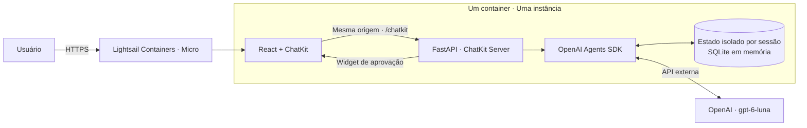

# Demonstração na AWS — Lightsail Containers

Preparação local, sem recursos AWS criados. Revisar e autorizar antes de executar
qualquer comando de criação, push ou deployment abaixo.

## Configuração proposta

| Item | Proposta |
| --- | --- |
| Região | `us-east-1`, mesma região do perfil AWS consultado |
| Serviço | Lightsail Containers **Micro**, scale **1** |
| Capacidade | 0,25 vCPU compartilhada, 1 GB de RAM |
| Preço consultado | **US$ 10/mês**, por nó, antes dos créditos e eventuais excedentes |
| Tráfego incluído | 500 GB/mês; excedentes são cobrados |
| HTTPS | Domínio padrão do Lightsail, sem comprar domínio ou certificado |
| Aplicação | Um container Linux amd64, Python 3.13 e frontend React compilado |
| Processo | Um Uvicorn worker, sem autoscaling |
| Dependências externas | OpenAI API e CDN do ChatKit |

A consulta de conta informou plano **Paid**, ativo, e saldo de **US$ 119,99** em
créditos. A titular confirmou Lightsail entre os serviços elegíveis e validade
até **22/08/2027**. Isso não é gratuidade permanente: créditos são compartilhados
com os demais serviços da conta. Custos não cobertos, excedentes e consumo após o
fim dos créditos podem ser cobrados. A OpenAI é faturada separadamente.
Revalidar saldo antes de criar. Não contratar planos maiores automaticamente.

Desabilitar o serviço NÃO encerra a cobrança: é preciso excluí-lo para parar o
custo do container. Fazer isso apenas com autorização. Recomenda-se uma janela
curta para a apresentação e revisão dos custos no console Billing.

Não há S3, CloudFront, ALB, NAT Gateway, banco ou ECR adicional nessa proposta.
A imagem será enviada ao registro privado do próprio serviço Lightsail.
O frontend permanece React/Vite, servido pelo FastAPI apenas quando FRONTEND_DIST
estiver definido. O desenvolvimento local usa frontend e backend em servidores separados.

## Fluxo da aplicação



As regras, valores financeiros e aprovação humana não mudam. O LLM nunca autoriza
pagamentos. Atualizar a página cria uma sessão nova. Reiniciar/republicar o
container perde conversas, pagamentos simulados e aprovações pendentes. Não usar
dados pessoais. Não ativar scale > 1 enquanto os dados permanecerem em memória.

## Build local (não cria recursos AWS)

Da raiz do repositório, iniciar Docker Desktop e executar:

```sh
docker build --platform linux/amd64 -f deploy/aws/Dockerfile -t finai-poc:local .
```

O build não precisa de chave OpenAI. O `.dockerignore` usa uma lista explícita de
fontes e assets, excluindo `.deploy`, credenciais, sessões, `.git` e arquivos locais.
A imagem final não inclui Node, dependências de frontend ou ferramentas de build.
O processo roda como usuário sem privilégios.

## Informar a chave sem enviá-la ao chat

```sh
.venv/bin/python deploy/aws/configurar_acesso.py
```

O comando solicita a chave com entrada oculta e grava `.deploy/aws-secrets.json`
com permissão 600. Esse arquivo é ignorado pelo Git e pelo Docker e será lido pelo
helper de deployment. Não imprime chaves nem acessa a AWS.

## Configuração pública em runtime

O React lê `/config.js` antes de iniciar. No container, esse endpoint publica
APENAS `chatkitApiURL` e `domainKey`. A chave OpenAI e o código de acesso não fazem
parte da imagem ou do frontend. Não é necessário reconstruir a imagem depois de
obter o hostname ou registrar o domínio do ChatKit.

Variáveis do backend:

| Variável | Valor |
| --- | --- |
| `OPENAI_API_KEY` | Chave privada, somente no backend |
| `DEMO_ACCESS_CODE` | Código privado compartilhado com participantes |
| `CHATKIT_DOMAIN_KEY` | Chave pública do domínio cadastrado no ChatKit |
| `PUBLIC_CHATKIT_API_URL` | `/chatkit` |
| `CORS_ORIGINS` | Origem HTTPS retornada pelo Lightsail |
| `APP_ENV` | `production` |
| `FRONTEND_DIST` | `/app/frontend-dist`, já definido na imagem |

As variáveis privadas ficam na configuração do deployment Lightsail. Usuários IAM
com permissão de leitura de deployments podem acessá-las; não conceder esse acesso
a participantes. Não imprimir o JSON de deployment em logs nem usar `set -x`.

## Testes locais

```sh
PYTHONPATH=assistente-organizacao-financeira .venv/bin/python -m unittest discover -s assistente-organizacao-financeira/tests -v
PYTHONPATH=assistente-organizacao-financeira:test-ui .venv/bin/python -m unittest discover -s test-ui/tests -v
```

O código de acesso e a chave precisam estar no ambiente para testar o container
em modo produção. Não use valores reais no comando `docker run` nem argumentos
visíveis: monte um arquivo privado ignorado `.deploy/container.env` e passe
`--env-file .deploy/container.env`. Ele deve ter permissões 600. Não há montagem de
arquivos de credenciais AWS dentro do container.

Para smoke test sem LLM: usar `APP_ENV=development` no container e `local-dev` no
ChatKit, somente na interface local `127.0.0.1`. Essa configuração não é publicável.

## Resultado da preparação local

- Build Linux amd64 concluído com as dependências fixadas, em ambiente limpo.
- Frontend Vite compilado dentro do estágio Node do Docker.
- Os testes de publicação cobrem isolamento e protocolo dentro do container Linux, sem rede/modelos:
  isolamento, autorização, concorrência, expiração, SSE, widgets, rejeição HITL e
  configuração pública sem segredos.
- Quatro testes de refatoração passaram no ambiente local.
- Smoke test HTTP local: `/`, `/health`, `/config.js`, criação de sessão e
  `threads.list` do ChatKit responderam corretamente.
- Container iniciado com limite de 1 GB e 0,25 CPU e usuário sem privilégios.
- Nenhum segredo real foi fornecido ao build ou aos testes. Nenhum pagamento
  recebeu aprovação automática. Validações reais com OpenAI e HTTPS/SSE do
  Lightsail permanecem pendentes da publicação e das credenciais.

## Criar o serviço — APÓS aprovação

Confirmar conta/perfil e saldo; não usar contas institucionais diferentes sem
verificar identidade. Definir um nome exclusivo para esta PoC em `FINAI_SERVICE`.

```sh
aws sts get-caller-identity
aws freetier get-account-plan-state --region us-east-1
aws lightsail create-container-service --region us-east-1 --service-name "$FINAI_SERVICE" --power micro --scale 1
```

A cobrança começa com a criação, mesmo sem deployment. Após isso, consultar só os
campos públicos para obter a URL e o estado:

```sh
aws lightsail get-container-services --region us-east-1 --service-name "$FINAI_SERVICE" --query 'containerServices[].{url:url,state:state,power:power,scale:scale}'
```

Cadastrar a origem HTTPS gerada na configuração de domínios do ChatKit e obter
seu domainKey público. Isso requer acesso ao projeto OpenAI da titular.

## Enviar imagem e preparar deployment — APÓS aprovação

O push do Lightsail requer Docker e o plugin `lightsailctl`. Se o plugin estiver
ausente, instalá-lo a partir da documentação oficial antes do push; a instalação
não faz parte das dependências da aplicação.

```sh
aws lightsail push-container-image --region us-east-1 --service-name "$FINAI_SERVICE" --label finai --image finai-poc:local
```

Usar a referência privada retornada no formato `:servico.finai.numero`, nunca uma
imagem pública que possa expor os fontes. Preparar o JSON privado local:

```sh
.venv/bin/python deploy/aws/preparar_deployment.py --url 'https://URL_REAL_LIGHTSAIL' --image ':REFERENCIA_PRIVADA' --domain-key 'DOMAIN_KEY_PUBLICO'
```

O helper solicita a chave OpenAI com entrada oculta (ou usa a variável de ambiente),
gera um código de acesso e grava `.deploy/aws-deployment.json` e
`.deploy/aws-demo-access-code.txt` com permissões 600. Ele não chama AWS nem publica.
Não sobrescreve arquivos existentes. Não enviar esses arquivos ao Git ou ao chat.

## Publicar — APÓS aprovação

```sh
aws lightsail create-container-service-deployment --region us-east-1 --service-name "$FINAI_SERVICE" --cli-input-json file://.deploy/aws-deployment.json --query 'containerService.{name:containerServiceName,state:state,url:url}'
```

A query exclui variáveis de ambiente da saída. Não executar o comando sem essa
filtragem se a saída for compartilhada. O endpoint público aponta para a porta
8000 e usa `/health` como health check.

## Verificar a demonstração

- `/health` retorna 200 e `/` mostra o frontend em HTTPS.
- `/config.js` contém somente os dois parâmetros públicos.
- Não há mixed content, erro de domínio ChatKit ou chave OpenAI no bundle.
- O código de acesso é exigido; duas sessões têm saldo e conversas independentes.
- Saldo, boletos e planejamento exibem os widgets corretos.
- Pagamento interrompe antes da execução; rejeição não altera saldo.
- Aprovação é feita manualmente pela titular no widget; reenvio não duplica pagamento.
- Verificar SSE e latência no endpoint público; smoke tests locais não validam o proxy AWS.
- Reinício invalida os tokens antigos e restaura a demonstração.
- Consultar Billing para confirmar aplicação efetiva dos créditos.

## Referências

- [Preços do Lightsail](https://aws.amazon.com/lightsail/pricing/)
- [Containers, HTTPS e cobrança mesmo com serviço desabilitado](https://docs.aws.amazon.com/lightsail/latest/userguide/amazon-lightsail-container-services.html)
- [Instalar ferramentas de containers](https://docs.aws.amazon.com/lightsail/latest/userguide/amazon-lightsail-install-software.html)
- [Créditos e Free Tier](https://aws.amazon.com/free/free-tier-faqs/)

## Correção de múltiplos pagamentos no HITL

O ChatKit apresenta uma operação pendente por vez. Cada widget carrega um
`approval_id` próprio; uma decisão afeta somente a chamada exibida. O SDK retoma
com essa decisão e conserva as chamadas que ainda aguardam revisão humana.
Widgets já decididos são substituídos antes de apresentar o próximo. Cliques
antigos ou sem identificador não executam operações.

O contador de buscas reinicia a cada nova solicitação e é preservado durante a
retomada HITL da mesma solicitação. Metadados de boletos já pagos continuam
consultáveis para montar widgets, e a regra financeira continua bloqueando
pagamentos duplicados e saldo insuficiente.

Para reproduzir os testes locais com modelo real, iniciar o container na porta
18080 com ambiente privado e executar `deploy/aws/validar_publicacao.py --local`.
O script rejeita as aprovações individualmente e nunca aprova pagamentos.
