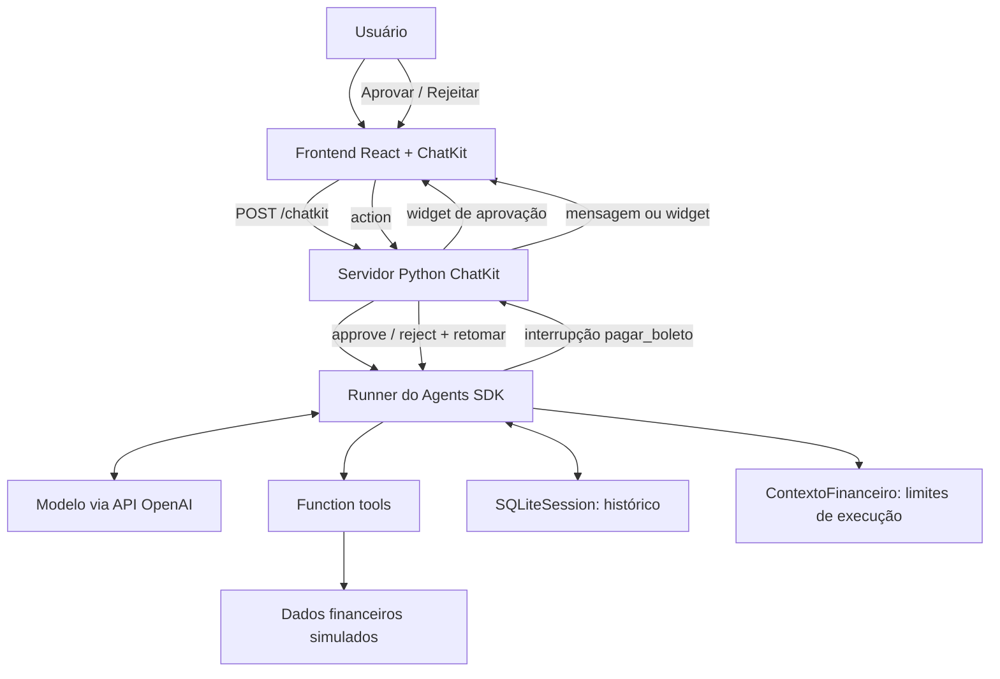
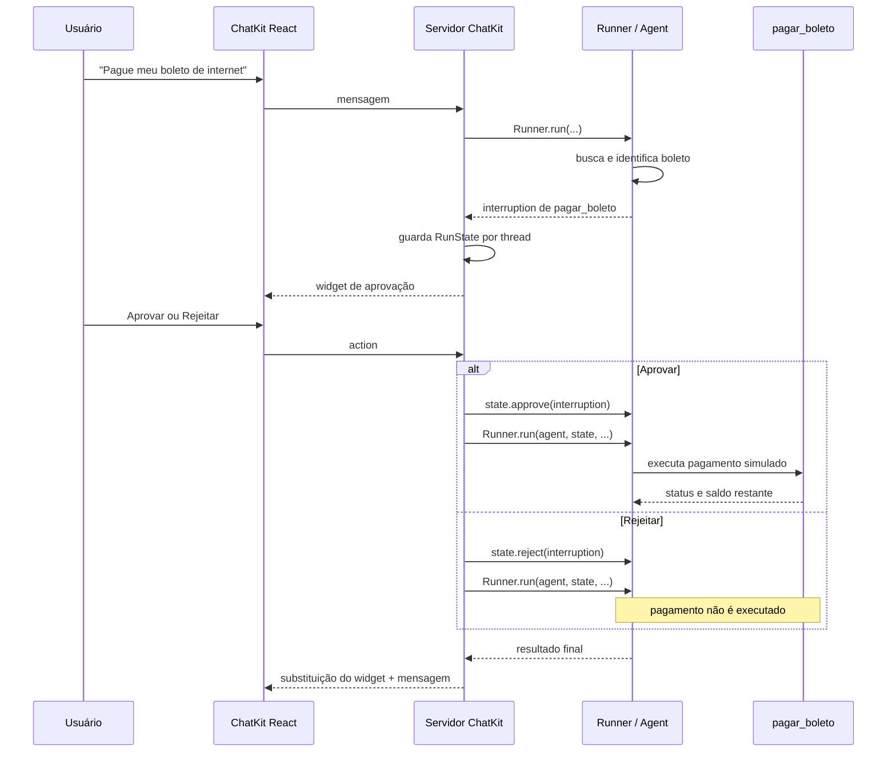

# PoC — Assistente Financeiro Inteligente

**Material de estudo técnico | OpenAI Agents SDK + ChatKit + Python + React**  
**Estado:** PoC funcional, com validações automatizadas e interface demonstrativa.  
**Escopo:** operações financeiras **simuladas**; nenhuma movimentação bancária real.

> Este documento revisa e amplia as anotações do `estudo.md` original. Descreve o que foi efetivamente construído e testado, separando isso de hipóteses, melhorias e requisitos de produção. Trechos de código são exemplos representativos da implementação discutida; não substituem uma leitura do repositório atualizado.

## 1. Objetivo e hipótese da PoC

Construir um assistente conversacional que compreende pedidos em linguagem natural, consulta saldo e boletos, ajuda a organizar pagamentos e **solicita autorização humana antes de executar um pagamento simulado**.

A pergunta central não era apenas “o modelo consegue responder?”, mas: **o agente consegue escolher e compor as ferramentas corretas, manter contexto entre mensagens e respeitar limites de execução impostos pela aplicação?**

### Capacidades estudadas

| Capacidade | O que é | Por que entrou na PoC | Estado |
|---|---|---|---|
| Agents SDK | Biblioteca Python para definir agentes, ferramentas e fluxos de execução | Testar orquestração entre interpretação e execução | Implementado |
| Agent | Configuração do modelo, instruções, ferramentas e saída | Concentrar a política de comportamento do assistente | Implementado |
| Runner | Motor que executa o ciclo do agente | Conduzir chamadas ao modelo, ferramentas, interrupções e retomadas | Implementado |
| Function tools | Funções Python expostas ao agente com contratos | Consultar dados e solicitar pagamentos simulados | Implementado |
| Session | Histórico de conversas entre turnos | Permitir referências a mensagens anteriores | Implementado com SQLiteSession |
| Contexto de execução | Estado Python entregue às ferramentas | Controlar contagem/limite de buscas sem depender da decisão do LLM | Implementado |
| Structured output | Resposta final validada contra schema | Separar mensagem, tipo e indicação de visualização | Implementado com Pydantic |
| Human-in-the-loop (HITL) | Interrupção que exige decisão humana | Impedir execução do pagamento sem aprovação | Implementado e testado |
| Tracing | Registro da execução em etapas e spans | Inspecionar chamadas ao modelo, tools e comportamento do HITL | Inspecionado durante o estudo |
| Evals | Cenários e critérios de avaliação reproduzíveis | Medir seleção de ferramentas e comportamento esperado | Implementado |
| ChatKit | Interface e protocolo para experiências conversacionais | Exibir chat, widgets e ações de aprovação | Implementado |
| Memória de preferências | Persistência seletiva de preferências/restrições além do histórico | Experimento de evolução | **Não validado como capacidade específica** |

## 2. Arquitetura geral



### Divisão de responsabilidades

- **LLM:** interpreta a intenção, resolve expressões em linguagem natural e escolhe quais ferramentas solicitar. Não é a autoridade final sobre dinheiro ou permissões.
- **Agent:** define instruções, conjunto de ferramentas e formato da resposta.
- **Runner:** coordena as etapas de execução, repassa contexto, executa ferramentas autorizadas e expõe interrupções.
- **Tools:** encapsulam operações disponíveis e seus parâmetros; retornam dados estruturados.
- **Backend financeiro:** valida existência de boleto, saldo, duplicidade e alterações de estado. É a fonte das regras determinísticas.
- **ChatKit server:** conecta a conversa ao Runner, transforma resultados em widgets e recebe ações da interface.
- **React/ChatKit:** apresenta a experiência ao usuário; não deve decidir se uma transação é autorizada.

**Princípio arquitetural central:** *o LLM interpreta intenções; a aplicação garante invariantes.*

## 3. Stack e componentes utilizados

### 3.1 Python

Linguagem usada no agente, nas tools, nas simulações, nos testes e no servidor ChatKit. Facilitou experimentação com o SDK e execução local.

### 3.2 OpenAI Agents SDK

O SDK fornece abstrações como `Agent`, `Runner`, `function_tool`, sessões, contexto e interrupções para aprovação. Em vez de implementar manualmente um loop de mensagens e tool calls, a PoC usa o Runner.

**Agent vs. Runner:** o `Agent` é a definição do assistente; o `Runner` é quem efetivamente conduz sua execução. Essa distinção importa porque configuração não é execução.

### 3.3 Responses API

API utilizada pelo ecossistema do agente para interagir com o modelo. **Não é sinônimo de Agents SDK:** a Responses API é uma interface de modelo; o SDK acrescenta abstrações de orquestração e gerenciamento do ciclo do agente. No trace observado apareceu uma chamada `POST /v1/responses`.

### 3.4 Pydantic

Biblioteca de modelagem e validação de dados Python. Foi usada para exigir que a resposta final do agente tenha uma estrutura conhecida, permitindo ao backend decidir como apresentá-la sem tentar interpretar texto livre novamente.

### 3.5 SQLiteSession

Sessão baseada em SQLite para preservar histórico de turnos. No servidor, uma sessão é associada a cada `thread.id` do ChatKit. Isso habilita interações *multiturn*; **não equivale automaticamente a memória duradoura de preferências**.

### 3.6 ChatKit Python + ChatKit React

O **ChatKit React** fornece a experiência conversacional no navegador. O **ChatKit Python server** implementa o lado servidor do protocolo, recebe mensagens e ações e emite eventos de conversa e widgets.

Foi escolhido porque o objetivo era validar comportamento do agente e interação humana, não construir um sistema de mensagens completo do zero. O custo é aceitar o modelo de componentes e os limites de customização do ChatKit.

### 3.7 FastAPI, Uvicorn e Vite

- **FastAPI:** expõe a integração HTTP do servidor de chat, incluindo `POST /chatkit`.
- **Uvicorn:** executa a aplicação ASGI localmente.
- **Vite + React:** ambiente de desenvolvimento e aplicação frontend.

## 4. Organização do projeto

Estrutura conceitual consolidada a partir dos arquivos trabalhados:

```text
test-openai-sdk/
├── assistente-organizacao-financeira/
│   ├── configuracao.py             # definição do Agent
│   ├── ferramentas.py              # function tools
│   ├── financeiro.py               # estado e regras financeiras simuladas
│   ├── ContextoFinanceiro.py       # contexto/limites por execução
│   ├── resposta_agente.py          # schema Pydantic da saída
│   └── tests/
│       ├── __init__.py
│       ├── test_avaliar_agente.py   # evals comportamentais
│       ├── testar_pagamentos.py    # testes determinísticos
│       └── testar_hitl.py          # aprovação/rejeição automatizadas
└── test-ui/
    ├── servidor_chatkit.py         # integração Runner ↔ ChatKit
    ├── api.py                      # endpoint HTTP
    ├── store_memoria.py            # store do ChatKit
    ├── widgets/
    │   ├── saldo.widget
    │   ├── boletos.widget
    │   ├── aprovacao.widget
    │   └── resultado_pagamento.widget
    └── frontend/
        └── src/
            ├── App.tsx
            ├── App.css
            └── index.css
```

> Os nomes refletem os arquivos mencionados na implementação; confira a árvore atual do repositório se houver renomeações posteriores.

## 5. Definição do agente e contrato de saída

A configuração do agente reúne suas instruções, ferramentas disponíveis e `output_type`.

Exemplo da estrutura da resposta:

```python
from decimal import Decimal
from typing import Literal
from pydantic import BaseModel, Field

class RespostaAgente(BaseModel):
    tipo: Literal["resposta", "solicitacao_informacao"]
    mensagem: str
    campo_pendente: str | None = None
    visualizacao: Literal["texto", "saldo", "lista_boletos"] = Field(default="texto")
    saldo: Decimal | None = None
```

**Por quê?** O servidor pode verificar `resposta.visualizacao == "saldo"` ou `"lista_boletos"` e construir o widget correspondente. O texto do agente deixa de ser o único canal para transmitir intenção de apresentação.

**Limite importante:** saída estruturada valida formato, mas não prova que o conteúdo está correto. Uma resposta pode obedecer ao schema e ainda trazer uma conclusão errada; daí a necessidade dos Evals e das regras de backend.

## 6. Ferramentas: contratos e seleção

Ferramentas exploradas na PoC:

| Ferramenta | Responsabilidade |
|---|---|
| `consultar_saldo` | Consultar saldo disponível simulado |
| `consultar_limite_cartao` | Consultar limite de crédito; distinguir crédito de dinheiro em conta |
| `listar_boletos_pendentes` | Listar compromissos disponíveis |
| `buscar_boletos` | Filtrar boletos pela descrição informada |
| `gerar_plano_pagamentos` | Apoiar planejamento de pagamentos |
| `pagar_boleto` | Solicitar execução simulada, condicionada a aprovação |

A assinatura e a docstring são parte do contrato oferecido ao modelo. **Nomes, descrições, parâmetros e instruções precisam ser coerentes**, pois influenciam a seleção da tool.

### 6.1 Exemplo: busca por descrição

```python
@function_tool(failure_error_function=None)
def buscar_boletos(
    ctx: RunContextWrapper[ContextoFinanceiro],
    descricao: str,
) -> list[dict]:
    if ctx.context.quantidade_buscas >= ctx.context.limite_buscas:
        raise LimiteBuscasExcedido("Limite de buscas atingido")

    ctx.context.quantidade_buscas += 1
    boletos = obter_boletos()
    return [
        b for b in boletos
        if descricao.casefold() in b["descricao"].casefold()
    ]
```

**Aprendizado:** o LLM escolhe a descrição a pesquisar; o Runner fornece o contexto; `ContextoFinanceiro` mantém o contador; o backend impõe o limite. O modelo não recebe a responsabilidade de “se policiar” para respeitar um limite operacional.

**Trade-off:** busca textual simples é fácil de testar e previsível, mas não resolve todas as equivalências semânticas. No experimento, “companhia de luz” não encontrou correspondência literal e o agente tentou “energia elétrica”, encontrando o boleto. A flexibilidade linguística ficou com o agente; o filtro continuou determinístico.

### 6.2 Quando pedir esclarecimento

Se o usuário disser “Pague meu boleto” sem identificar qual, o comportamento esperado é **pedir informação adicional**, não escolher arbitrariamente um compromisso. Essa hipótese foi incluída nos Evals.

## 7. Estado financeiro e regras determinísticas

O arquivo `financeiro.py` mantém um estado de demonstração:

```python
from decimal import Decimal

estado_financeiro = {
    "saldo": Decimal("350.00"),
    "pagamentos_realizados": set(),
}
```

Dados de exemplo utilizados:

| ID | Descrição | Valor | Vencimento |
|---|---|---:|---|
| BOL-001 | Energia elétrica | R$ 280,00 | 26/10/2026 |
| BOL-002 | Internet | R$ 149,90 | 28/10/2026 |
| BOL-003 | Água | R$ 92,50 | 27/10/2026 |

### Regras validadas

1. **Boleto inexistente:** retornar erro sem alterar o saldo.
2. **Saldo insuficiente:** impedir o pagamento sem alterar o estado.
3. **Pagamento válido:** descontar o valor e registrar o identificador como pago.
4. **Pagamento duplicado:** impedir nova cobrança do mesmo boleto.

Exemplo representativo:

```python
def executar_pagamento_simulado(boleto_id: str) -> dict:
    if boleto_id in estado_financeiro["pagamentos_realizados"]:
        return {"status": "ERRO", "motivo": "Boleto já pago"}

    boleto = next(
        (b for b in obter_boletos() if b["id"] == boleto_id),
        None,
    )
    if boleto is None:
        return {"status": "ERRO", "motivo": "Boleto inexistente"}

    valor = Decimal(str(boleto["valor"]))
    saldo = Decimal(str(obter_saldo()))
    if valor > saldo:
        return {"status": "ERRO", "motivo": "Saldo insuficiente"}

    estado_financeiro["saldo"] -= valor
    estado_financeiro["pagamentos_realizados"].add(boleto_id)
    return {
        "status": "PAGO",
        "boleto_id": boleto_id,
        "valor": str(valor),
        "saldo_restante": str(estado_financeiro["saldo"]),
    }
```

**Por que `Decimal`?** Valores monetários devem evitar erros de representação binária de ponto flutuante. Como melhoria, a função de consulta de saldo também deveria preservar `Decimal` em vez de converter para `float`.

**Limitação da simulação:** o `set` em memória ajuda a testar duplicidade sequencial, mas não é idempotência transacional robusta. O estado global não oferece isolamento por usuário, persistência ou segurança contra concorrência.

## 8. Human-in-the-loop (HITL): o principal mecanismo de segurança da PoC

### 8.1 O que é

HITL é um ponto explícito em que a execução automatizada **para e aguarda uma decisão humana**. É diferente de o agente apenas perguntar “posso pagar?” em texto: o bloqueio acontece no mecanismo de execução da ferramenta.

### 8.2 Definição da ferramenta protegida

```python
@function_tool(needs_approval=True)
def pagar_boleto(boleto_id: str) -> dict:
    """Executa um pagamento simulado após aprovação humana."""
    print(f"[TOOL] Executando pagamento: {boleto_id}")
    return executar_pagamento_simulado(boleto_id)
```

`needs_approval=True` informa ao SDK que a execução depende de autorização. A ferramenta **não deve ser executada no momento em que o modelo a solicita**.

### 8.3 Fluxo completo



### 8.4 Implementação no servidor

No `servidor_chatkit.py`:

- `Runner.run(...)` retorna um resultado que pode conter `interruptions`.
- O servidor chama `resultado.to_state()` e guarda o estado em `estados_pendentes[thread.id]`.
- `obter_boleto_aprovacao(state)` verifica se há **exatamente uma** interrupção e se a ferramenta é `pagar_boleto`; extrai o `boleto_id` e consulta o boleto.
- `emitir_aprovacao(...)` constrói o widget e o envia à interface.
- Enquanto há decisão pendente, novas mensagens não iniciam outra execução; o usuário é orientado a usar os botões.
- Em `action(...)`, o servidor chama `state.approve(...)` ou `state.reject(...)` e **retoma** com `Runner.run(agent, state, context=...)`.

Trecho conceitual:

```python
if resultado.interruptions:
    state = resultado.to_state()
    boleto = self.obter_boleto_aprovacao(state)
    self.estados_pendentes[thread.id] = state
    async for evento in self.emitir_aprovacao(thread, context, boleto):
        yield evento
    return
```

E na decisão:

```python
if action.type == "aprovar_pagamento":
    state.approve(interrupcao)
else:
    state.reject(
        interrupcao,
        rejection_message="Pagamento rejeitado pelo usuário.",
    )

resultado = await Runner.run(
    agent,
    state,
    context=self.contextos_financeiros[thread.id],
)
```

### 8.5 O que ocorre na rejeição

Um resultado observado nos estudos foi:

```text
Tipo: tool_call_output_item
Resultado: Tool execution was not approved.
```

Isso demonstra que o SDK registrou a não aprovação e permitiu ao agente continuar para explicar o desfecho. **Rejeitar não equivale a executar a tool e depois desfazer a operação.**

### 8.6 Atenção ao status exibido

Na implementação analisada, a aprovação levava ao título **“Pagamento processado”** e a rejeição a **“Pagamento rejeitado”**. Isso foi uma escolha prudente: clicar em Aprovar não garante que a regra financeira retornará `PAGO` (por exemplo, pode haver saldo insuficiente). Uma evolução necessária é derivar “Pagamento realizado” **do retorno efetivo da ferramenta**, não do clique.

## 9. ChatKit: interface e integração

### 9.1 Por que usar ChatKit?

O objetivo era demonstrar um assistente com conversa, histórico, cards financeiros e decisões humanas. ChatKit reduziu o trabalho de construir a infraestrutura visual e o protocolo de chat, deixando mais tempo para validar o comportamento do agente.

**Trade-off:** acelera a PoC, mas a interface fica sujeita aos componentes, esquemas de widgets e possibilidades de customização da biblioteca.

### 9.2 React: conexão com o servidor

Exemplo do `App.tsx`:

```tsx
import { ChatKit, useChatKit } from "@openai/chatkit-react";
import "./App.css";

export default function App() {
  const { control } = useChatKit({
    api: {
      url: "http://localhost:8000/chatkit",
      domainKey: "local-dev",
    },
  });

  return <ChatKit control={control} className="chatkit" />;
}
```

A aplicação final inclui um container e identidade visual próprios; o exemplo acima mostra apenas a conexão essencial. `domainKey: "local-dev"` corresponde ao ambiente local da PoC, não a uma configuração de produção.

### 9.3 Servidor ChatKit

O servidor herda de `ChatKitServer[dict]` e implementa, entre outros pontos:

- `respond(...)`: recebe mensagem, executa o agente e emite resposta textual ou widget.
- `action(...)`: recebe ações dos botões de aprovação/rejeição.
- `emitir_mensagem(...)`: cria `AssistantMessageItem` dentro de `ThreadItemDoneEvent`.
- `stream_widget(...)`: transmite widgets para a conversa.

O servidor mantém estruturas por `thread.id`: sessões, contextos financeiros, estados pendentes e referências aos widgets de aprovação. Isso permitiu associar cada decisão à conversa correta na demonstração.

### 9.4 Widgets utilizados

| Widget | Finalidade |
|---|---|
| `saldo.widget` | Apresentar saldo em formato visual |
| `boletos.widget` | Exibir lista de boletos, valores e vencimentos |
| `aprovacao.widget` | Mostrar detalhes e botões de aprovar/rejeitar |
| `resultado_pagamento.widget` | Substituir o card de decisão por um resultado sem botões ativos |

Os templates são carregados com `WidgetTemplate.from_file(...)` e preenchidos com `build({...})`.

### 9.5 Como os boletos são renderizados

O arquivo `boletos.widget` usa um `Card` com conteúdo dinâmico:

```json
{
  "version": "1.0",
  "name": "boletos_pendentes",
  "template": "{\"type\":\"Card\",\"children\":{{ children }}}"
}
```

O servidor inspeciona os `ToolCallOutputItem` do resultado e procura uma lista de dicionários com `id`, `descricao`, `valor` e `vencimento`. Em seguida, constrói os componentes visuais. A primeira versão mostrava uma linha de texto por boleto; a versão revisada organizou descrição, vencimento e valor em linhas, com divisórias e totalização.

**Aprendizado:** CSS do React estiliza o contêiner externo, mas a estrutura do card é definida pelos componentes do widget enviados pelo servidor. Por isso a melhoria real da lista exigiu alteração em `servidor_chatkit.py`, não apenas em `App.css`.

### 9.6 Substituição do widget após decisão

Ao receber um `ThreadItemDoneEvent` de `stream_widget`, o servidor guarda o `WidgetItem` original. Após a decisão, atualiza seu conteúdo e emite:

```python
widget_original.widget = widget_final
widget_original.copy_text = titulo
yield ThreadItemReplacedEvent(item=widget_original)
```

**Por quê?** O card antigo deixa de mostrar botões de uma aprovação já resolvida. A interface representa o estado atual da operação e evita induzir o usuário a tentar uma nova decisão sobre a mesma solicitação.

### 9.7 Ajustes visuais feitos

Foram experimentados layout externo, cabeçalho, espaçamento, paleta clara e organização dos boletos. Um fundo escuro causado por estilos globais do frontend produziu uma experiência visual ruim e foi removido. A versão mantida prioriza fundo claro e conversa legível. Refinamentos adicionais foram conscientemente adiados: **não são necessários para validar a hipótese central da PoC**.

## 10. Sessões, contexto e memória: conceitos diferentes

Esses termos parecem próximos, mas resolvem problemas distintos:

| Conceito | Onde aparece | O que guarda | Limitação |
|---|---|---|---|
| Histórico de sessão | `SQLiteSession(thread.id)` | Mensagens e contexto conversacional | Não é memória semântica de longo prazo |
| Contexto de execução | `ContextoFinanceiro()` | Contador e limite de buscas | É estado de aplicação, não conhecimento do modelo |
| Estado de HITL | `RunState` em `estados_pendentes` | Execução interrompida aguardando decisão | No exemplo, fica em memória do processo |
| Estado financeiro simulado | `financeiro.py` | Saldo e boletos pagos | Não é banco de dados transacional |
| Store do ChatKit | `StoreMemoria` | Estruturas necessárias ao chat | Não equivale automaticamente à memória do agente |

**Ponto de estudo:** uma futura avaliação pode comparar o comportamento com e sem histórico, ou testar memória explícita de preferências. Não há resultado quantitativo desse experimento no material atual.

## 11. Tracing: entender o que realmente aconteceu

**Tracing** registra etapas de uma execução: chamadas ao modelo, turnos, ferramentas e outras operações. É essencial para depurar sistemas com agentes porque a resposta final sozinha não explica o caminho seguido.

Painel usado nas anotações: <https://platform.openai.com/logs?api=traces>

### 11.1 Observação: consulta de boletos

O trace registrado no estudo mostrava:

1. Execução do assistente financeiro.
2. Um `turn` de processamento.
3. Uma chamada `POST /v1/responses`.
4. Uma chamada à ferramenta `listar_boletos_pendentes`.

A anotação registrou **aproximadamente 4,46 s no total** e **menos de 1 ms para a ferramenta**. Nessa observação específica, isso sugere que o tempo estava concentrado fora da execução local da ferramenta, especialmente nas etapas envolvendo o modelo. **Não é benchmark de latência nem média estatística.**

### 11.2 Observação: pagamento e dois spans

Outro trace mostrava **dois spans associados a `pagar_boleto` em dois grupos `task`**. Isso merece investigação, mas **não prova duas execuções efetivas do pagamento**. Pode refletir a interrupção e a retomada do HITL.

Para investigar corretamente, comparar:

- argumentos de cada span;
- estado de aprovação;
- retorno de cada ferramenta;
- logs de execução efetiva (`[TOOL] Executando pagamento`);
- alteração de saldo e registro do boleto pago.

Essa distinção é fundamental: **quantidade de spans ≠ quantidade de transações concluídas**.

## 12. Evals e testes: o que foi medido

Três níveis de avaliação foram estudados:

1. **Comportamental:** o agente escolheu a ferramenta correta? Pediu esclarecimento quando necessário? Solicitou HITL?
2. **Determinístico:** as regras financeiras impediram saldo negativo, boleto inexistente e duplicidade? A rejeição preservou o estado?
3. **Semântico:** a resposta comunicou corretamente o resultado e os dados? Esse nível foi discutido, mas não há uma bateria semântica independente quantificada no material.

### 12.1 Evals do agente — 30/30

Foram executados **seis cenários, cinco repetições cada**, todos aprovados nos critérios definidos:

| Cenário | Critério principal | Resultado |
|---|---|---|
| Consultar saldo | Usar ferramenta adequada | 5/5 |
| Buscar boleto de internet | Buscar boleto por descrição | 5/5 |
| Listar boletos pendentes | Listar compromissos | 5/5 |
| Solicitar pagamento da internet | Buscar e chegar à interrupção HITL | 5/5 |
| “Pague meu boleto” | Solicitar informação, sem pagar | 5/5 |
| “Pode pagar aquele boleto para mim?” | Solicitar informação, sem pagar | 5/5 |

O script de avaliação examina itens de execução, como `ToolCallItem`, `resultado.interruptions` e `resultado.final_output.tipo`. Isso é mais verificável do que simplesmente ler uma resposta e dizer que “pareceu correta”.

**Interpretação correta:** 30/30 significa 100% **nessa amostra e nesses critérios**, não uma garantia de comportamento universal.

### 12.2 Testes das regras financeiras — 4/4

Script: `tests/testar_pagamentos.py`.

```text
[PASSOU] Boleto inexistente
[PASSOU] Saldo insuficiente
[PASSOU] Pagamento realizado
[PASSOU] Pagamento duplicado
=== RESULTADO: 4/4 ===
```

Esses testes são determinísticos e não precisam chamar o modelo. Cada cenário restaura o saldo e o conjunto de pagamentos, evitando interferência entre testes.

### 12.3 Testes automatizados de HITL — 2/2

Script: `tests/testar_hitl.py`.

```text
[PASSOU] Rejeição não altera saldo
[TOOL] Executando pagamento: BOL-002
[PASSOU] Aprovação executa pagamento
```

O teste inicia uma solicitação de pagamento e verifica que existe uma interrupção **antes de qualquer alteração financeira**. Depois exercita os dois caminhos:

- **Rejeição:** retoma o Runner com `state.reject(...)`; o saldo permanece intacto e não há registro de pagamento.
- **Aprovação:** retoma com `state.approve(...)`; o boleto é pago uma vez e o saldo é reduzido de R$ 350,00 para **R$ 200,10**.

Os resultados enviados confirmaram ambos os cenários como aprovados. A linha de resumo final `2/2` não foi incluída no trecho de saída compartilhado, mas as duas linhas `[PASSOU]` foram observadas.

### 12.4 Consolidação

| Grupo | Aprovados | Total |
|---|---:|---:|
| Evals comportamentais | 30 | 30 |
| Regras financeiras | 4 | 4 |
| HITL automatizado | 2 | 2 |
| **Total** | **36** | **36** |

Além disso, aprovação e rejeição na interface ChatKit foram testadas manualmente. **Não somamos esses testes manuais às 36 execuções automatizadas.**

### 12.5 Como executar após mover os testes para `tests/`

A partir da pasta `assistente-organizacao-financeira`:

```bash
python -m tests.test_avaliar_agente
python -m tests.testar_pagamentos
python -m tests.testar_hitl
```

A pasta `tests/` possui `__init__.py`. Usar `python -m` a partir da raiz resolve imports como `from configuracao import agent`, que falhavam ao executar o arquivo diretamente dentro de `tests/`.

## 13. Fluxos demonstráveis de ponta a ponta

### Fluxo A — Consulta de saldo

1. Usuário pergunta pelo saldo.
2. Agente escolhe `consultar_saldo`.
3. Ferramenta retorna dado simulado.
4. Resposta estruturada indica visualização `saldo`.
5. Servidor cria `saldo.widget` e envia ao ChatKit.

### Fluxo B — Listagem de boletos

1. Usuário pergunta “Quais boletos eu tenho?”.
2. Agente solicita `listar_boletos_pendentes`.
3. Servidor identifica a lista retornada pela ferramenta.
4. Constrói o widget com descrição, vencimento, valor e total.
5. ChatKit exibe o card.

### Fluxo C — Solicitação ambígua

1. Usuário diz “Quero pagar”.
2. Agente identifica falta de informação.
3. Resposta `solicitacao_informacao` pergunta qual boleto deve ser pago.
4. **Nenhuma ferramenta de pagamento é executada.**

### Fluxo D — Pagamento com autorização

1. Usuário solicita pagamento da internet.
2. Agente busca `BOL-002`.
3. Agente solicita `pagar_boleto`.
4. SDK interrompe por `needs_approval=True`.
5. Servidor mostra card com dados do boleto.
6. Usuário aprova ou rejeita.
7. Servidor retoma o `RunState`.
8. Se aprovado, a ferramenta aplica as regras financeiras; se rejeitado, não executa.
9. Card é substituído e o agente comunica o resultado.

## 14. Decisões e trade-offs importantes

| Decisão | Benefício | Custo / limite |
|---|---|---|
| Um agente inicialmente | Menos complexidade de orquestração | Não explora especialização multiagente |
| Tools com stubs e dados simulados | Isola comportamento do agente de integrações reais | Não valida sistemas bancários reais |
| Busca por descrição | Simples e verificável | Equivalência semântica depende do agente |
| Regras no backend | Invariantes verificáveis | Exige contratos e validações explícitas |
| `needs_approval=True` | Bloqueio real da execução da tool | Exige persistir/gerenciar estado de interrupção |
| `SQLiteSession` | Multiturn sem infraestrutura complexa | Não substitui gestão de memória de longo prazo |
| Pydantic na resposta | Contrato estável para UI | Não garante veracidade semântica |
| ChatKit | Rapidez para chat e widgets interativos | Customização visual condicionada ao SDK |
| Estado financeiro em memória | Testes rápidos e baratos | Sem persistência, isolamento ou concorrência segura |
| Evals repetidos | Evidência mais sólida que um único exemplo | Cobertura ainda pequena e cenários controlados |

## 15. O que a PoC **não** prova

A PoC **não** está pronta para pagamentos reais. Para evoluir, seriam necessários pelo menos:

- **Autenticação e autorização:** identificar cliente, conta e permissões; nunca confiar em `boleto_id` ou dados vindos apenas da interface.
- **Isolamento por cliente:** estado e dados segregados por usuário/conta.
- **Idempotência transacional:** chaves de idempotência e garantia contra repetição sob concorrência e retries.
- **Persistência e transações:** banco de dados, controle de concorrência, recuperação de falhas e trilha de auditoria.
- **Autorização robusta:** aprovação vinculada a usuário, boleto, valor, prazo e contexto; prevenir replay e dupla submissão.
- **Verificação do resultado real:** diferenciar solicitado, aprovado, processando, pago e falhou; não inferir sucesso do clique.
- **Segurança de ferramentas:** validação de parâmetros, limites, tratamento de dados sensíveis e controles contra prompt injection.
- **Observabilidade operacional:** métricas, alertas, logs estruturados, correlação entre conversas e transações, políticas de retenção e privacidade.
- **Evals ampliados:** entradas adversariais, linguagem ambígua, falhas de tools, concorrência, regressões e casos de borda.
- **Ciclo de vida do estado HITL:** armazenamento durável de aprovações pendentes, expiração, recuperação após reinício e tratamento de múltiplas instâncias.

**Ponto de atenção específico:** a versão estudada usa estruturas em memória para `estados_pendentes` e `widgets_aprovacao`; uma reinicialização do processo pode perder decisões pendentes.

## 16. Próximos experimentos de estudo (não implementados/validados aqui)

1. **Comparar instruções do agente:** medir diferenças na seleção de tools com o mesmo conjunto de casos.
2. **Comparar com e sem histórico:** testar referências como “pague aquele da internet” em múltiplos turnos.
3. **Memória seletiva:** avaliar se preferências persistidas melhoram planejamento sem introduzir dados incorretos.
4. **Evals semânticos:** avaliar precisão de explicações, identificação de risco e qualidade da comunicação.
5. **Falhas controladas:** simular timeout de tool, resposta inválida, indisponibilidade e retomada de HITL.
6. **Observabilidade de pagamentos:** comparar spans com execuções efetivas, estados e IDs de operação.
7. **Aprimorar widget de resultado:** mostrar “Pagamento realizado” somente quando o retorno real indicar `PAGO`.

Não há números para esses experimentos; devem ser medidos quando executados.

## 17. Glossário rápido

- **Agente:** sistema configurado com modelo, instruções e ferramentas para resolver tarefas.
- **LLM:** modelo de linguagem que interpreta solicitações e produz decisões/saídas textuais ou estruturadas.
- **Tool calling:** solicitação estruturada do modelo para usar uma função disponibilizada pela aplicação.
- **Runner:** componente que executa e coordena o ciclo do agente.
- **Session / multiturn:** manutenção do histórico para conversas com várias mensagens.
- **Contexto de execução:** objeto da aplicação disponível para as ferramentas, sem ser necessariamente parte do texto enviado ao modelo.
- **HITL:** aprovação humana exigida antes de executar uma ação protegida.
- **Interruption:** pausa explícita do fluxo aguardando decisão.
- **RunState:** estado serializável/retomável de uma execução interrompida.
- **Widget:** componente visual estruturado apresentado dentro do chat.
- **Event stream:** sequência de eventos usada para atualizar a interface.
- **Tracing / span:** registro de uma execução e de suas etapas internas.
- **Eval:** teste com entrada, critério e verificação de resultado.
- **Invariante:** regra que deve continuar verdadeira independentemente do comportamento do modelo.
- **Idempotência:** propriedade pela qual repetir uma operação com a mesma identidade não produz efeitos duplicados.

## 18. Síntese dos aprendizados

A PoC saiu de uma ideia de “chat que paga boletos” e se tornou um experimento sobre **fronteiras de responsabilidade**:

1. O modelo interpreta linguagem natural e escolhe ferramentas, mas **não é fonte de verdade financeira**.
2. O Runner coordena o fluxo, enquanto o backend garante as regras.
3. A aprovação humana precisa ser um **controle de execução**, não apenas uma frase de confirmação.
4. ChatKit ajuda a demonstrar ações e estados, mas a interface deve refletir o resultado real das operações.
5. Traces ajudam a explicar o percurso, porém não devem ser confundidos com prova de efeitos financeiros.
6. Evals e testes determinísticos são complementares: um mede comportamento do agente; o outro protege invariantes.
7. **36/36 verificações automatizadas passaram nos cenários definidos**, o que sustenta a demonstração da PoC, sem extrapolar para confiabilidade de produção.

### Frase para apresentar a solução

> “O agente entende o que o cliente quer fazer; as ferramentas e o backend definem o que pode ser feito; e a aprovação humana controla quando uma ação sensível pode ser executada.”

---

## Referências para continuar estudando

- [OpenAI Agents SDK — documentação](https://openai.github.io/openai-agents-python/)
- [OpenAI API — documentação](https://platform.openai.com/docs/)
- [OpenAI Traces — painel](https://platform.openai.com/logs?api=traces)
- Código da própria PoC: `configuracao.py`, `ferramentas.py`, `financeiro.py`, `servidor_chatkit.py`, `tests/` e `widgets/`.

*Documento elaborado a partir do `estudo.md` original, dos trechos de implementação compartilhados e dos resultados de testes observados durante a construção da PoC.*
